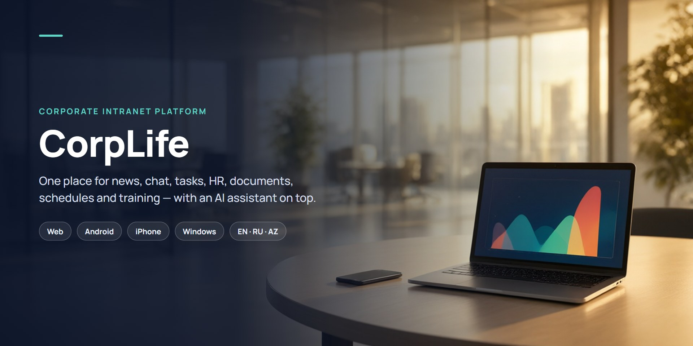
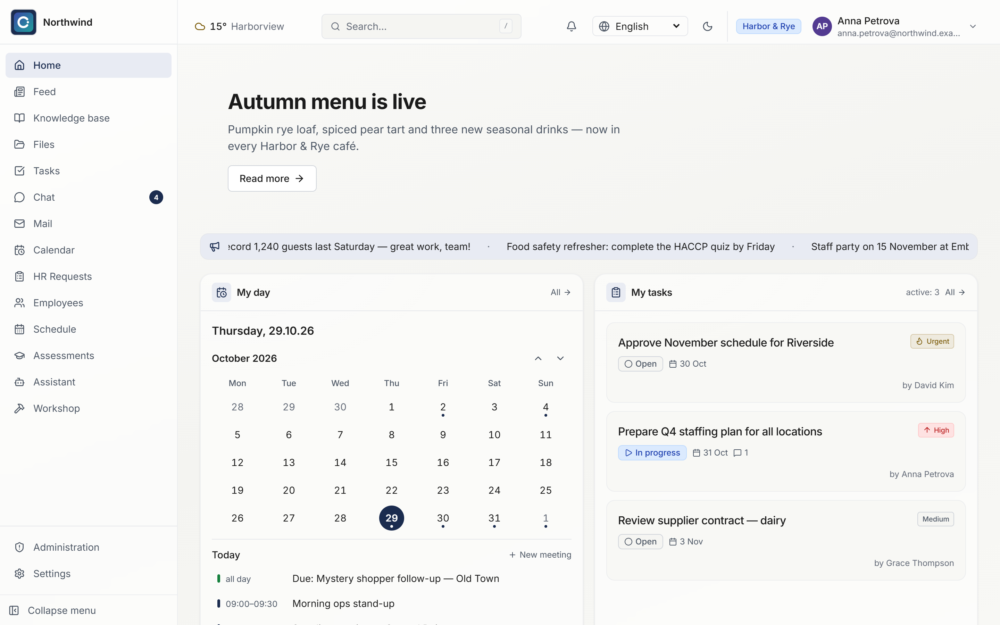
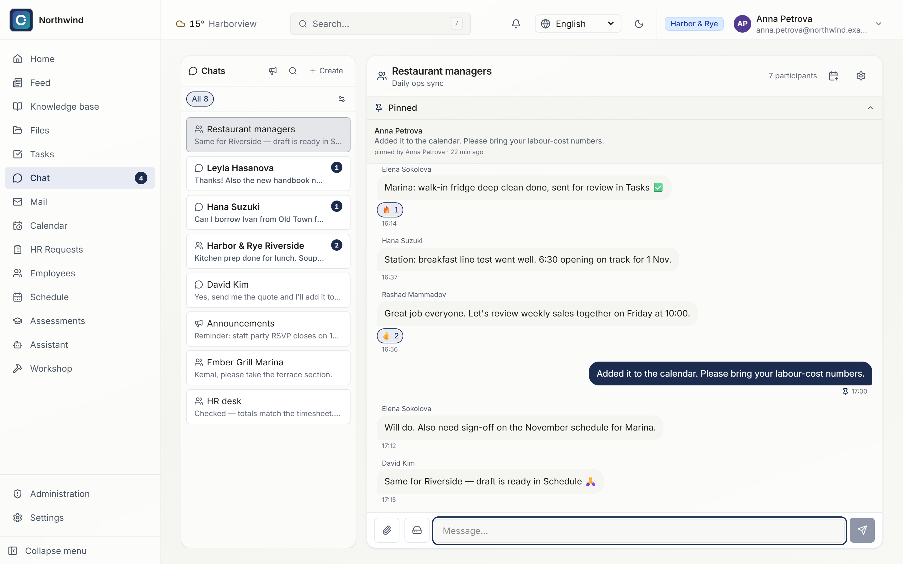
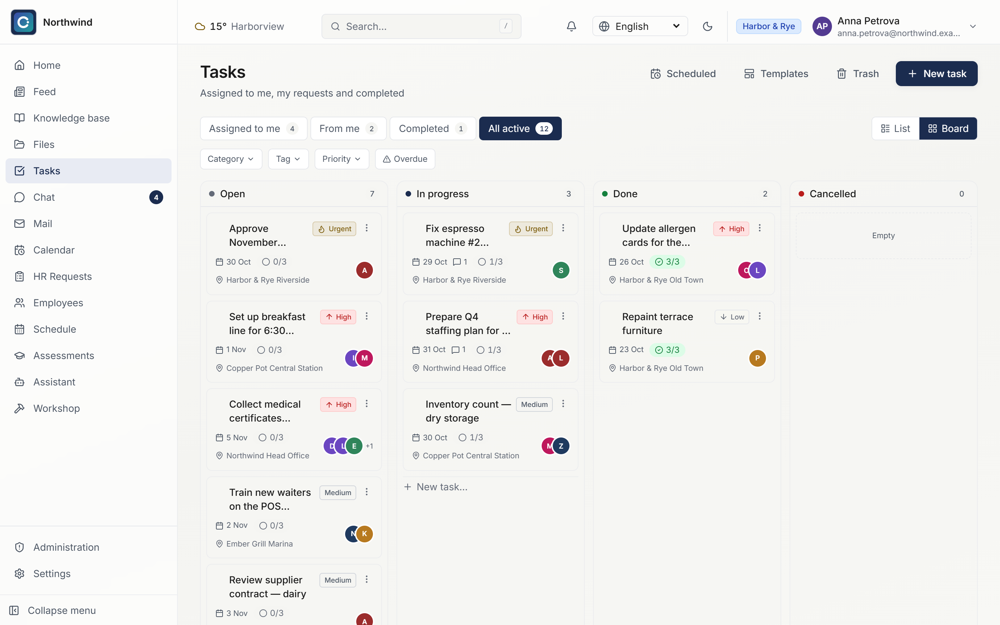
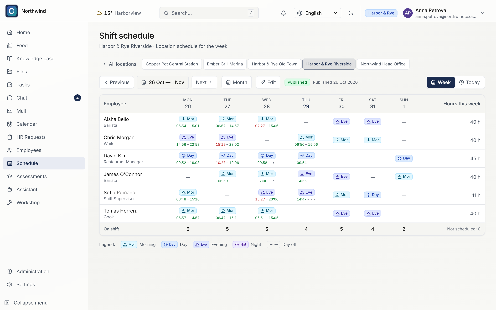
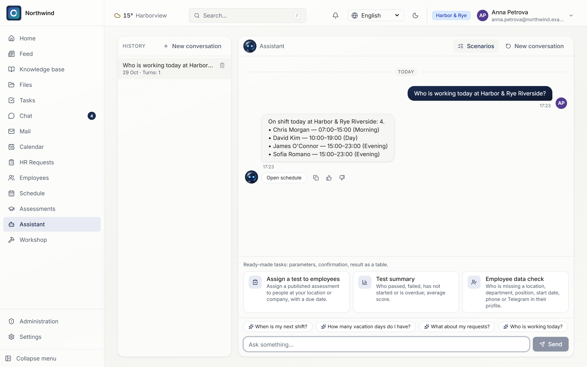
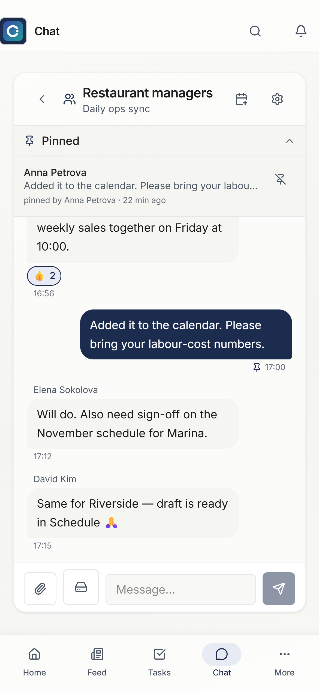

  

# CorpLife

**Corporate intranet platform.** One place for news, chat, tasks, HR requests, documents, schedules, training and meetings — replacing a mix of separate apps. In production at a multi-brand restaurant holding and offered as a product to other companies.

## Who it's for

Companies with many locations and shift-based staff — restaurant and café chains, hotels, retail — where head office, managers and front-line employees need one shared workspace on desktop and on the phone.

## Key features

- **News and announcements** with a home page that brings together the news feed, "my day" calendar and my tasks.
- **Team chat** — groups, channels and direct messages with pins, reactions, files and unread badges.
- **Tasks** — list and kanban board with priorities, due dates, checklists, assignees, locations, templates and scheduled tasks.
- **HR requests and employee records** — leave, documents and other requests with approval flows.
- **Shift schedules and attendance** — weekly schedules per location, with actual check-in and check-out times from fingerprint terminals.
- **Knowledge base and documents** — policies, orders and manuals with mandatory acknowledgement, so managers see who has read an order.
- **Training and assessments** — tests for employees with results by person and location.
- **Meetings and calendar.**
- **Visibility for managers** — sales, attendance and acknowledgements without phone calls.
- **Built-in AI assistant** — answers employee questions from company documents, schedules and sales reports.
- **Granular access control** — permissions by role and scope (own / location / company) with per-person overrides.

## Platforms

Web, Android, iPhone and Windows. Interface in English, Russian and Azerbaijani.

## Screenshots

All screenshots use demo data for a fictitious hospitality company.

**Home** — news, "my day" calendar and my tasks in one place.

**Team chat** — groups, channels and direct messages with pins and reactions.

**Tasks** — kanban board with priorities, due dates, checklists, assignees and locations.

**Shift schedule** — weekly schedule per location with actual check-in/out times from fingerprint terminals.

**AI assistant** — answers "who is working today" from the live schedule.

<table>
  <tr>
    <td width="320"></td>
    <td><b>On the phone</b> — the same workspace on mobile: chat, feed, tasks and the rest of the portal.</td>
  </tr>
</table>

## Stack

TypeScript · Next.js · React · React Native (Expo) · Tauri · Prisma · PostgreSQL · MinIO · WebSockets · Docker

## Source code

Source code is private — demo on request.

## Contact

Zulfi Aliyev · alliyev.zulfi95@gmail.com · [sci-fi.az](https://sci-fi.az) · [LinkedIn](https://www.linkedin.com/in/zulfi-aliyev/)
